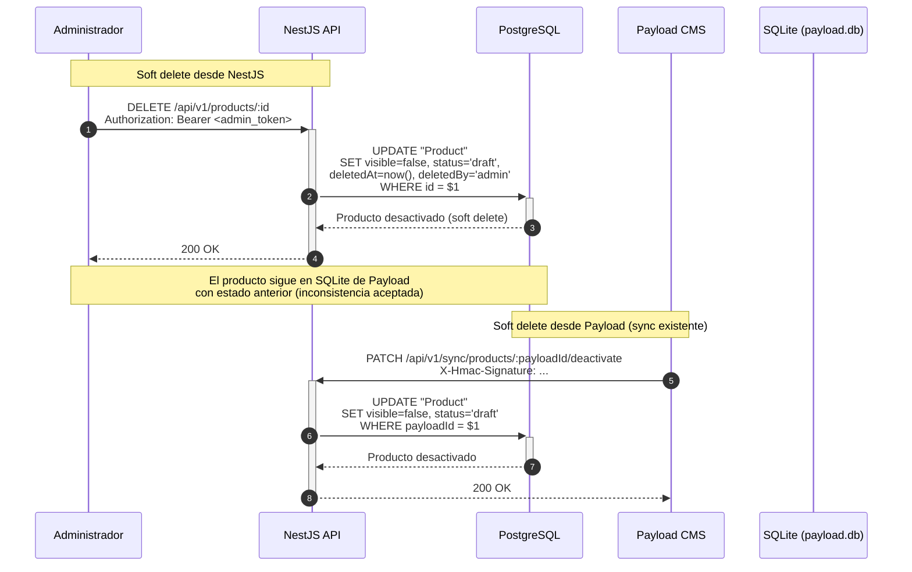

# ADR-P03: Eliminación lógica de productos (soft delete) (Diseño Técnico Detallado)

## Metadatos

| Campo | Valor |
|-------|-------|
| Identificador | ADR-P03 |
| Título | Los productos utilizarán eliminación lógica. No se permitirá la eliminación física mediante los endpoints ordinarios del catálogo |
| Estado | ACCEPTED (arquitectura) / PENDING (diseño técnico detallado) |
| Fecha | 2026-11-05 |
| Autores | Equipo de arquitectura Portal San Pablo |

---

## 1. Campos deletedAt y deletedBy

### Nuevas columnas en la tabla `Product` (PostgreSQL)

| Columna | Tipo | Nullable | Descripción |
|---------|------|----------|-------------|
| `deletedAt` | TIMESTAMP(3) | Sí | Fecha y hora en que se desactivó lógicamente el producto |
| `deletedBy` | TEXT | Sí | Identificador del usuario o servicio que realizó la desactivación |

> **Nota:** Estas columnas no existen actualmente en el esquema Prisma. Su agregado requiere una migración de Prisma (pendiente de ejecución, no parte de este diseño).

### Uso de los campos

| Estado | visible | status | deletedAt | deletedBy | Significado |
|--------|---------|--------|-----------|-----------|-------------|
| Activo y publicado | true | 'published' | NULL | NULL | Producto visible al público |
| Borrador | true | 'draft' | NULL | NULL | Producto no publicado aún |
| Oculto | false | 'published' | NULL | NULL | Producto publicado pero no visible |
| Eliminado lógicamente | false | 'draft' | fecha | usuario/servicio | Producto desactivado (soft delete) |

---

## 2. Comportamiento de ProductService

### Método `remove` (actual: hard delete)

**Estado actual:** `this.prisma.product.delete({ where: { id } })` — borra físicamente el registro.

**Nuevo comportamiento:** `this.prisma.product.update({ where: { id }, data: { visible: false, status: 'draft', deletedAt: new Date(), deletedBy: userId } })` — desactiva lógicamente.

### Método `restore` (nuevo)

Permite reactivar un producto desactivado lógicamente:

```typescript
async restore(id: number, restoredBy: string) {
  const existing = await this.prisma.product.findUnique({ where: { id } });
  if (!existing) throw new NotFoundException(`Producto con id ${id} no encontrado`);
  
  return this.prisma.product.update({
    where: { id },
    data: {
      visible: true,
      status: 'published',
      deletedAt: null,
      deletedBy: null,
    },
  });
}
```

### Método `findAll` (filtro por defecto)

**Estado actual:** Devuelve todos los productos sin filtro.

**Nuevo comportamiento:** Por defecto, `findAll` debe filtrar:
```typescript
where: {
  status: 'published',
  visible: true,
  deletedAt: null,
}
```

Esta filtración debe aplicarse automáticamente cuando se consulta desde el storefront (lectura pública). Para lecturas administrativas (con autenticación), se puede omitir el filtro mediante un parámetro opcional.

### Método `findBySlug`

Mismo filtro por defecto que `findAll`.

---

## 3. Filtros predeterminados

### Lectura pública (storefront sin autenticación)

```sql
WHERE status = 'published' 
  AND visible = true 
  AND deletedAt IS NULL
```

### Lectura administrativa (con autenticación, rol admin/editor)

Sin filtro obligatorio; el administrador decide qué ver. Se puede agregar un parámetro opcional `includeDeleted` para ver productos desactivados.

### Lectura de sincronización (Payload → NestJS)

El endpoint de sync (`POST /api/v1/sync/products`) recibe productos de Payload y los crea/actualiza. Si Payload envía un producto con `visible=false`, NestJS debe respetarlo y no anularlo con el filtro por defecto. El filtro por defecto solo aplica a consultas GET, no a operaciones de sync.

---

## 4. Recuperación de productos

### Operación de restauración

Un producto desactivado lógicamente se puede restaurar mediante:
1. Endpoint dedicado: `PATCH /api/v1/products/:id/restore` (solo admin).
2. Actualización normal: `PATCH /api/v1/products/:id` con `visible=true` y `status='published'`.

En ambos casos, `deletedAt` y `deletedBy` se establecen en `null`.

### Limitaciones

- No se puede restaurar un producto que nunca existió (obviamente).
- Si se necesita eliminar físicamente por razones legales (GDPR, etc.), se requeriría un proceso administrativo separado fuera de los endpoints ordinarios.

---

## 5. Diferencia entre borrador, oculto y eliminado

| Concepto | `status` | `visible` | `deletedAt` | ¿Visible al público? | ¿Recuperable? |
|----------|----------|-----------|-------------|---------------------|---------------|
| Borrador (draft) | 'draft' | true | NULL | No | Sí (publicarlo) |
| Oculto | 'published' | false | NULL | No | Sí (activar visibilidad) |
| Eliminado (soft delete) | 'draft' | false | fecha | No | Sí (restaurar) |

La diferencia clave es que un producto eliminado tiene `deletedAt` poblado, lo que permite distinguirlo de un producto que simplemente nunca se publicó o se ocultó temporalmente.

---

## 6. Auditoría y consistencia con Payload

### Auditoría en NestJS

- `deletedAt`: marca cuándo se desactivó.
- `deletedBy`: quién lo desactivó (ID de usuario o "system" si fue por sync desde Payload).
- Se recomienda agregar `updatedAt` automáticamente por Prisma (`@updatedAt`).

### Consistencia con Payload CMS

La arquitectura es unidireccional: Payload → NestJS. Esto implica:

1. **Cuando Payload elimina un producto:** El hook `afterDelete` llama a `deactivateProductInNestJS`, que hace soft delete en PostgreSQL (`visible=false`, `status='draft'`). El producto sigue existiendo en SQLite de Payload.
2. **Cuando NestJS desactiva directamente:** No hay notificación a Payload. El producto sigue existiendo en SQLite con su estado anterior. Esta es una inconsistencia aceptada por la arquitectura unidireccional.

### Sincronización de estado desde Payload

Si un producto se reactiva en Payload (cambio de `visible` o `status`), el hook `afterChange` enviará la actualización a NestJS mediante `syncProductToNestJS`, que hará upsert y restaurará el producto en PostgreSQL.

---

## 7. Diagrama de secuencia



---

## 8. Criterios de aceptación verificables

| Criterio | Cómo verificarlo |
|----------|-----------------|
| `DELETE /products/:id` no borra físicamente | Enviar DELETE; verificar que el registro sigue en PostgreSQL con `visible=false` |
| `GET /products` público no devuelve productos desactivados | Consultar GET sin autenticación; verificar que no aparezcan productos con `deletedAt` poblado |
| Producto desactivado se puede restaurar | Enviar PATCH con `visible=true`, `status='published'`; verificar que vuelve a aparecer en GET público |
| Campos `deletedAt` y `deletedBy` se populan | Consultar registro desactivado; verificar que ambos campos tienen valor |
| Soft delete desde Payload funciona | Eliminar producto en Payload; verificar que en PostgreSQL aparece `visible=false`, `status='draft'` |

---

## 9. Archivos que probablemente habrá que modificar

| Archivo | Cambio probable |
|---------|-----------------|
| `apps/api/prisma/schema.prisma` | Agregar campos `deletedAt` y `deletedBy` al modelo `Product` |
| `apps/api/src/products/products.service.ts` | Cambiar `remove()` a soft delete; agregar `restore()`; agregar filtro por defecto en `findAll` |
| `apps/api/src/products/products.controller.ts` | Agregar endpoint `PATCH /products/:id/restore` (opcional); agregar guard de autenticación a `remove` |
| `apps/api/prisma/migrations/` | Nueva migración para agregar columnas `deletedAt` y `deletedBy` |

---

## 10. Riesgos

| Riesgo | Impacto | Mitigación |
|--------|---------|------------|
| Consultas olviden filtrar por `deletedAt IS NULL` | Medio | Aplicar filtro por defecto en el servicio, no solo en el controlador |
| Acumulación de registros desactivados | Bajo | Proceso de archivado opcional (no borrado físico) |
| Inconsistencia entre SQLite y PostgreSQL | Medio | Documentar que NestJS soft delete no notifica a Payload |

---

## Decisiones técnicas que necesitan validación

1. ¿Se agrega `deletedAt` y `deletedBy` al esquema Prisma y se genera una migración?
2. ¿Se crea un endpoint dedicado `PATCH /products/:id/restore` o se usa el `PATCH` general para restaurar?
3. ¿El filtro por defecto se aplica también al endpoint de sincronización o solo a GET?

---

**Estado del diseño:** PENDIENTE de validación del equipo antes de implementar.